# 📚 作业小站

给一年级小朋友做的**作业 + 每日任务**共享网站。

老师把作业发在钉钉群里，家长在公司收到后，复制粘贴进去，一键拆分；
孩子在家用平板或电脑打开同一个网址，就能看到今天要做什么，做完自己打勾，
家长下班后确认，小红花到账，攒够了可以换奖励。

| 孩子看到的 | 家长录作业 | 小红花 | 这一周 |
|---|---|---|---|
| 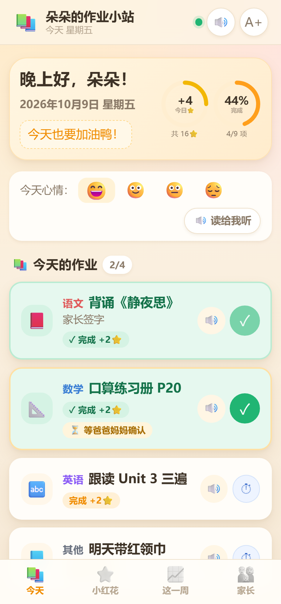 | 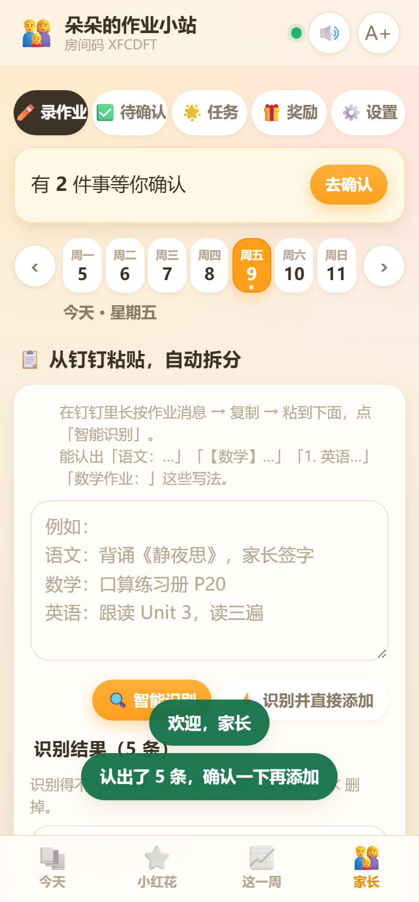 |  | 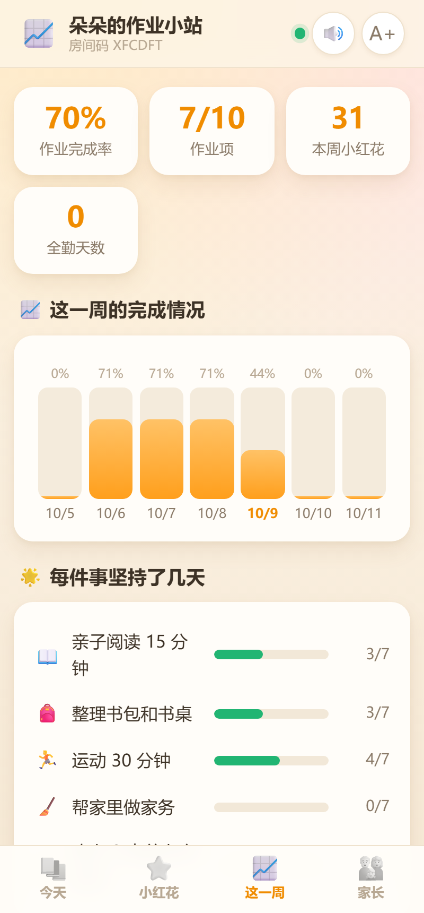 |

---

## ✨ 有什么功能

**孩子端（默认打开就是这一页）**
- 大字号、大按钮、卡通配色，不看字也能认出图标
- 首页第一行是放大的问候语，下面跟着「2026年10月9日 星期五」
- 右边**两个小圆环**（和任务进度同一个设计）：
  左边是**今日小红花**（中间 `+4`，整个圆是今天所有任务的分值，弧线是已经拿到的），
  右边是**任务进度**（中间 `44%`，下面是 `4/9 项`）。一眼看出今天赚了多少、做完多少
- 「今天的作业」和「每天要做的事」两个标题后面都跟着 `已完成/总数`，全做完会变绿
- 今天的作业按科目分色，**科目和标题排在同一行**；**没有详细要求就不占那一行**
- **作业和每日任务都不能直接点完成**：卡片右边 🔊 后面就是 **⏱**，
  点它（或直接点卡片）进入整页专注，做完在专注页上按「✓ 我做完了」才算完成
- **⏱ 专注时间**：**整页**变成倒计时（默认 20 分钟），圆环顺时针走着收口；
  时间到了还没做完，会换成绿色的休息页休息 5 分钟，休息完自动开始下一轮
- 😄 记录今天的心情，家长能看到
- 🔊 **读给我听**：一年级识字少，可以把作业念出来
- 卡片结构固定：科目+标题一行、详细要求一行（有才显示）、小红花一行；
  「等爸爸妈妈确认」接在小红花后面，不占小红花的位置
- 全部完成会撒花庆祝
- 小红花余额 + 兑换奖励（家长驳回时会看到原因）
- 这一周的完成率、每件事坚持了几天、连续全勤天数

| 专注中（整页倒计时） | 时间到，强制休息 |
|---|---|
| 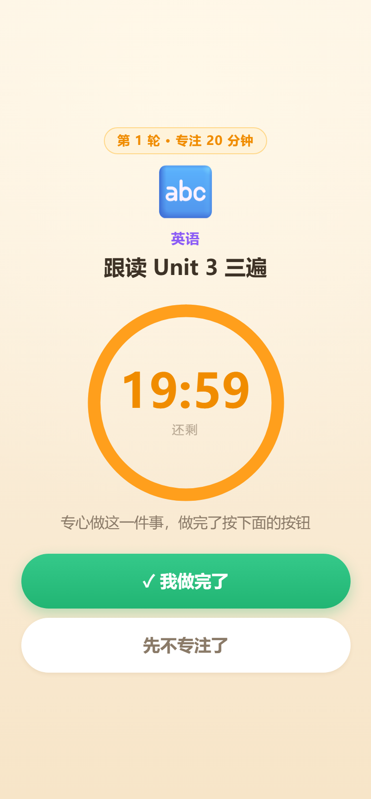 |  |

**家长端（4 位密码进入，默认 `1234`）**
- 密码键盘是 3×4 排满的：`1-9` 占上面三行，最后一行 `清空` / `0` / `删除`
- **电脑上可以直接敲数字键**，`Backspace` 退一位、`Delete` / `Esc` 清空
- **只有还是初始密码时**才提示「初始密码 1234」；你在基本设置里改过之后这个提示就消失，不再暴露默认值
- **30 秒没动静就自动重新上锁**，三种「人走开了」都算：
  1. **离开家长页**（切到「今天 / 小红花 / 这一周」）
  2. **就在家长页上晾着不动**
  3. **切出网站**（切到别的 App 或别的标签页）—— 切出去的这段时间也算数

  反过来说，30 秒内切回来、或者一直在家长页上点来点去，都不会被踢出去。
  刷新页面、关标签页、切换房间同样会重新上锁
- **家长端五个模块（录作业 / 待确认 / 每日任务 / 奖励 / 设置）按钮等宽等大**，一眼扫过去整齐
- **从钉钉粘贴，自动拆分**：能认出「语文：…」「【数学】…」「1. 英语…」「数学作业：」这些写法，自动分好科目、拆出备注
- **识别结果可以逐条改**：点哪一条就改哪一条（科目 / 内容 / 备注都能改），不要的点 ✕ 删掉
- 每一行都是「**内容在左、按钮在右**」：↑ ↓ 排序、✎ 改、✕ 删（每日任务还多一个「停用」）
- **清单完全套用孩子端卡片的排版**：左边是图标块，右边是科目 + 标题、详细要求、
  小红花徽章，最右边才是那排按钮
- **同一个科目的作业会自动挨着放**：粘贴或手动添加时，新的一条插到最后一条同科目后面
- 后面的时间统一是 `2026-10-09 12:04:38` 这种完整格式，
  **和「等确认 / 已确认 / 已兑现」标签同一行**
- 手动加一条时「备注」是多行文本框，可以写好几行（比如「家长签字」+「明天带红领巾」）
- **每条作业的小红花可以单独设**：点 ✎ 打开修改框，里面有「小红花」一栏；
  留空就跟着设置里的全局分值走
- **顶部一条本周日期条**：周一到周日七天都显示日期，点哪天就编辑哪天，今天有个小圆点；
  两边的 ‹ › 可以往前 / 往后翻一周
- 手动加一条 / 改 / 删，可以翻到本周任意一天
- 复制昨天的作业
- **待确认清单**：孩子做完的作业、任务，加上**孩子提出的兑换申请**，都在这里一起处理 ——
  确认、撤销，或者**驳回兑换并写一句原因**（原因会显示给孩子，小红花自动退回）。
  已兑现的兑换也会出现在「已确认」里，可以退回重办；
  每个模块顶部都有一个靠右的 **去确认** 按钮，直接跳过来
  - **兑换列表的两条规矩**（第 92 轮）：
    - **待处理（pending）的一直显示**，不分日期 —— 直到家长点「兑现 / 驳回」
      （孩子不提，家长可能好几天后才看到，藏起来就漏了）
    - **已兑现（done）的只显示「当前这一天兑现的」** —— 按 `resolvedAt` 折算成日期和
      `S.date` 比。原来是无脑全列（还只截前 8 条），日子一长"今天"这一页上堆着一堆
      上个月的兑换，分不清哪些是今天的
    - **已兑现的都要显示兑现日期**（第 95 轮）：`resolvedAt`（退回 `ts`）
      - 孩子的小红花页：`📺 看 10 分钟纪录片 [已兑现] 10/18 -15⭐` ——
        日期用 `M/D` 短格式（一行要塞下图标 + 标题 + 徽章 + 日期 + 花掉的分），
        **完整时间放在 `title` 里**，鼠标停上去能看到
      - 家长的「已确认」：`✓ 已兑现 2026-10-18 17:03:47 花掉 15⭐`（一直是完整时间）
- 管理每日任务（可以临时「停用」而不删掉）和奖励清单，新增 / 修改时可以从**一排常用图标**里点选
- **「已撤销」区块认三种情况**（第 92 轮补了第三种）：
  ① 选了「任务取消」② 选了「再完善」③ **撤销了但没写理由**（只写了说明也算）。
  > 踩过：`item.undo` 不选理由时 `undoKind` 和 `undoReason` **都是空串**，只写 `undoneAt`。
  > 而过滤条件原来只看 `undoKind || undoReason` → 这种记录
  > **待确认里没有、已确认里没有、已撤销里也没有**，只有小红花流水里留下 +2 / -2 一对，
  > 家长看到的就是"这条记录哪来的"。真实案例：2026-10-19 的「绿豆成长日记」
  > （17:28:37 确认 +2 → 17:28:49 撤销 -2）。判定改成
  > `!done && (undoKind || undoReason || undoneAt)`。
- **🏠 房间管理**（设置页最上面）
  - 场景是「**一台服务器 = 一个家庭 = 几个孩子的房间**」，房间之间不需要权限隔离
  - **标题栏三个按钮**：`➕ 新建` / `↻ 刷新` / `🔐 口令`，和其他面板的按钮同一套样式
  - 标题下面一句话说明「每个房间是一份独立的数据」
  - **房间名 + 孩子名字**都在这儿改，**保存按钮就在那一行**；
    房间名留空就按 **「XX的作业小站」**（XX 是孩子名字）显示
  - **房间码也能自己定** —— 想用 `duoduo` 这种好记的网址也行，系统会检查重名、太短、纯数字会给警告
  - **房间列表自动读出来**（不需要口令），**正在使用的那个置顶并且永远完整摊开**
  - **其他房间折叠成一摞卡片压在它下面**：和上面那张一样宽，每张被遮住约 2/3
    （只露下面 1/3），越往下越淡，最多露 3 张；**点当前房间的中间区域**就能展开 / 收起
  - 折叠时每张卡片点一下可以**直接切过去**；展开后每个房间是完整一行，能改能删能切
  - 每个房间一行，四个同一套风格的文字按钮：
    - `复制网址` 直接发给另一台设备
    - `编辑` 改那个房间的房间名和孩子名字
    - `删除` 删掉那个房间（**要把房间码打一遍**；删之前必须先设过管理口令）
    - `切换` 换到那个房间（正在使用的那个没有这个按钮，改成「正在使用」徽章）
  - **正在使用的房间不给删**（按钮灰掉并说明原因）；**至少要保留一个房间**（服务端也会拦）
  - **管理口令是可选的**：只在删除房间时用来确认一下，平时浏览、切换、改名都不要
  - 连不上服务器时，退回到「这台设备进过的房间」列表，照样能切

| 其他房间折叠成一摞 | 点中间展开 | 删房间要先打房间码 |
|---|---|---|
|  |  |  |

| 起坑：休息也有转圈倒计时 | 录入作业：三种方式 | 从常用作业库选 |
|---|---|---|
| 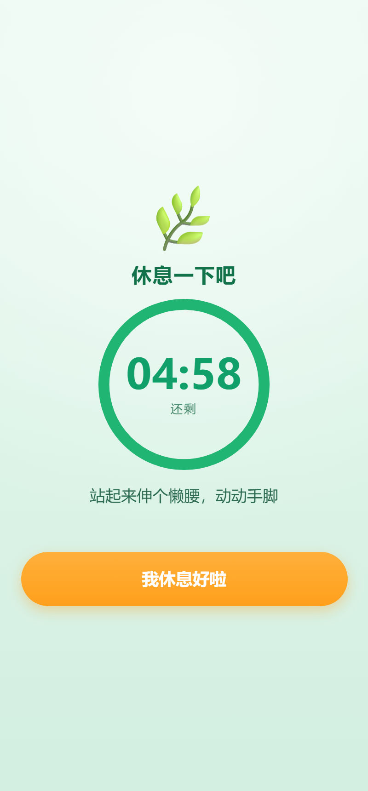 |  | 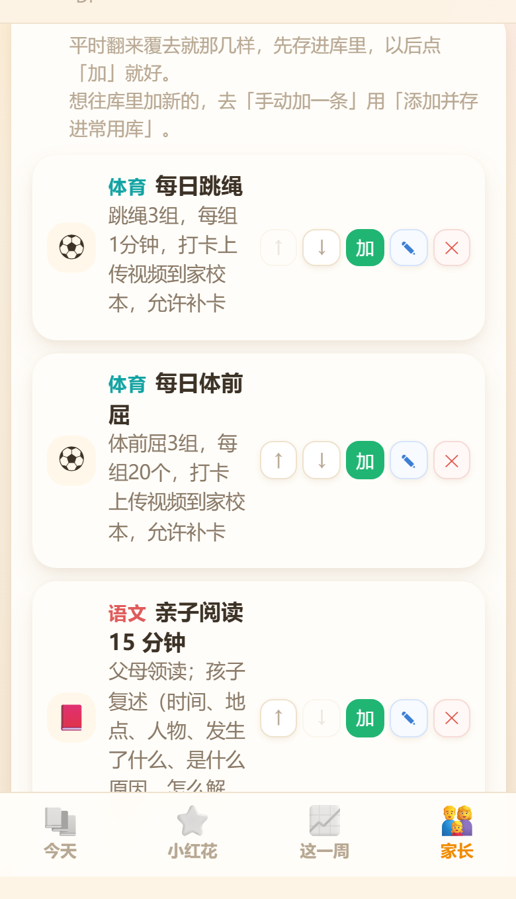 |

| 手动加一条（三样同一行） | 修改奖励（加减真的能点） | 同名覆盖提示 |
|---|---|---|
| 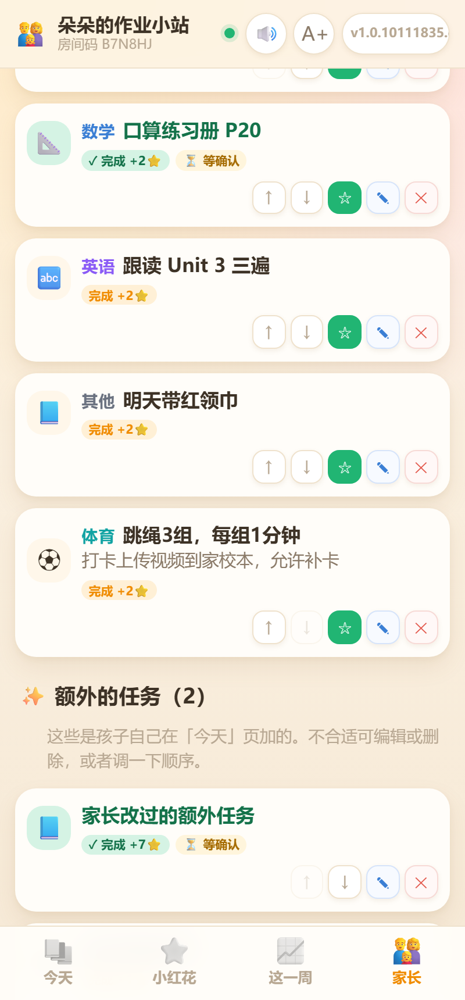 |  |  |

| 录入作业：传附件 | 交作业：传照片 / 视频 / 录音 | 家长在「待确认」里看孩子交的 |
|---|---|---|
| 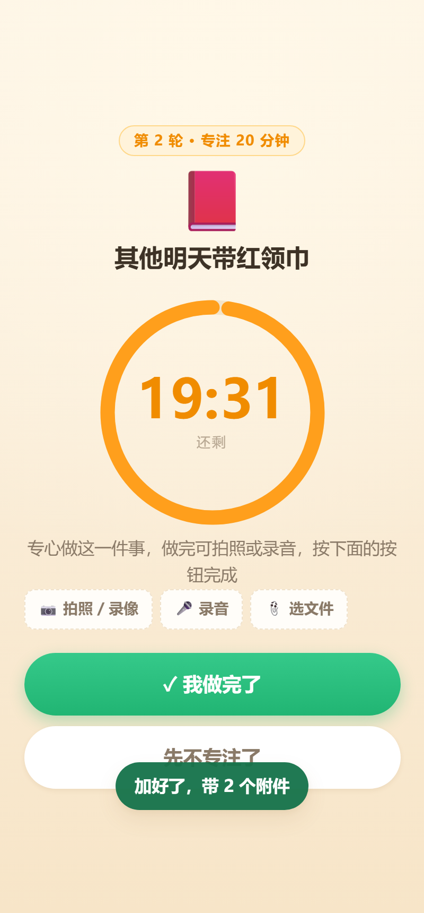 | 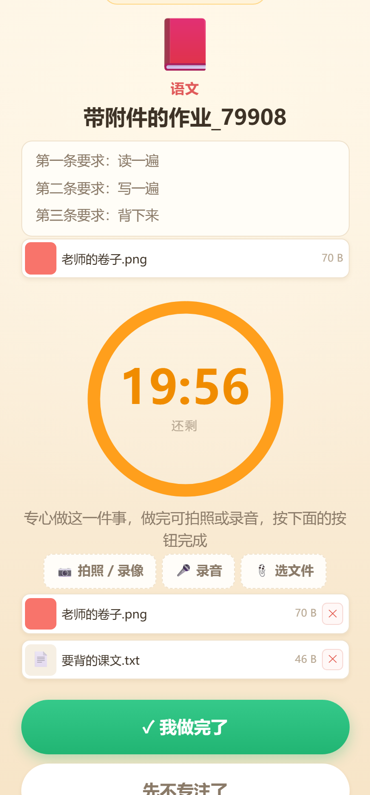 | 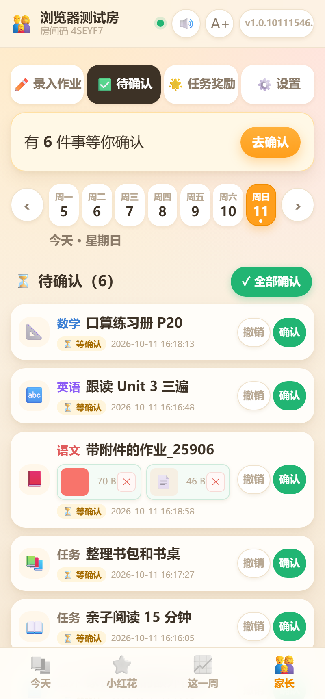 |

| 手动加一条（说明合并成一句 + 附件） | 手机端：家长录入作业 | 手机端：孩子今天 |
|---|---|---|
| 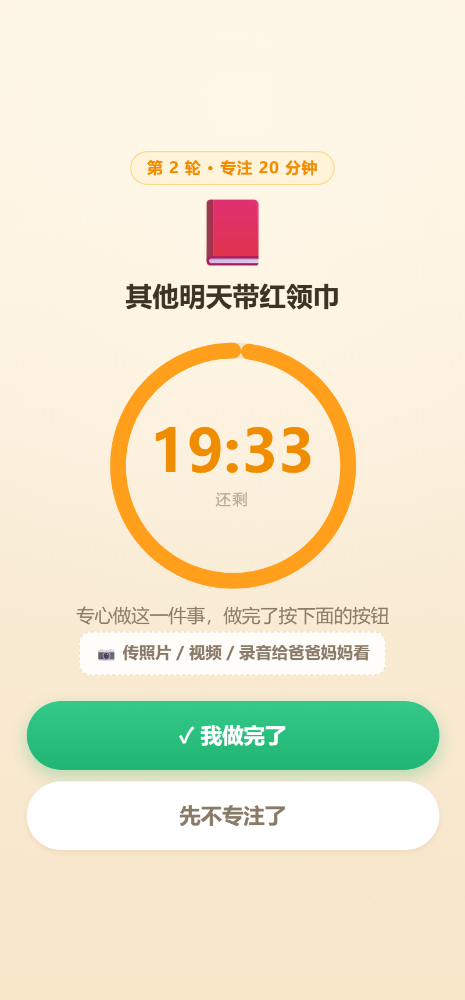 |  |  |

| 撤销要填理由 | 已撤销（家长看得到自己写的理由） | 孩子那边也能看到理由 |
|---|---|---|
|  |  |  |

| 修改作业（小红花与评价同款） | 给孩子留句话（默认「三到」） | 加一件事（带备注、小红花固定） |
|---|---|---|
| 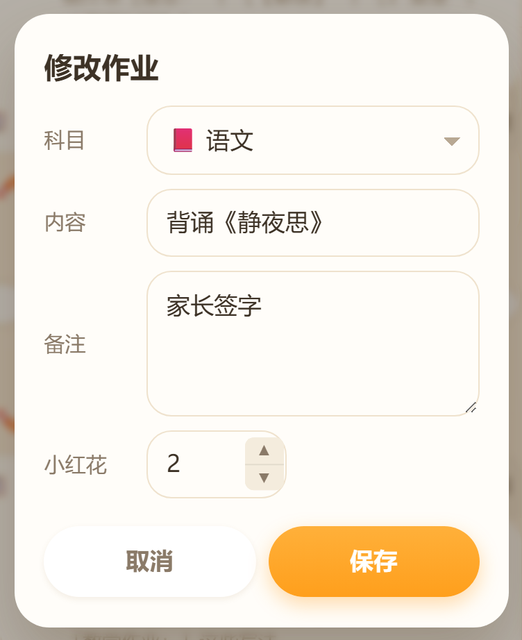 | 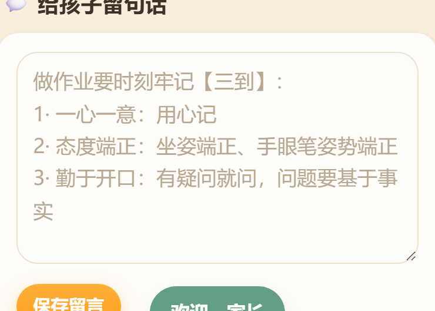 |  |

| 常用库条目 | 今日学习评价 | 小红花那一行（负数也正常） |
|---|---|---|
|  |  |  |

| 图标直接点选（和「任务」等宽） | 设置页（说明同行 + 上下加减） | 作业行里的按钮 |
|---|---|---|
|  | 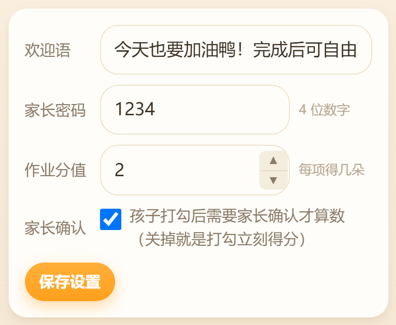 | 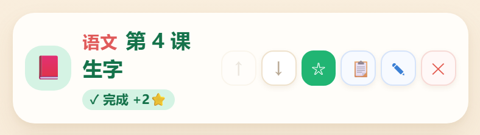 |

| 新建房间：说明和输入框左对齐 | 奖励停用 / 启用 | 点右上角版本号看更新内容 |
|---|---|---|
|  |  | 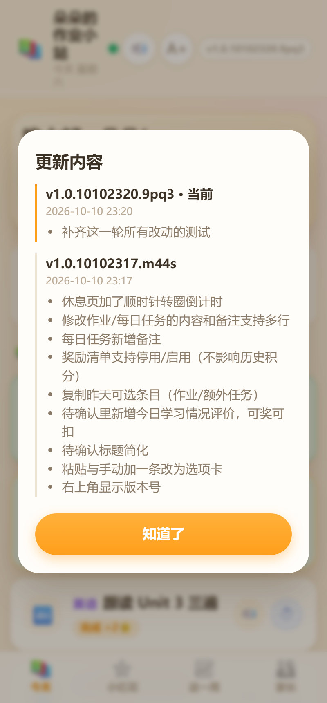 |

| 房间列表 | 改房间名 / 孩子名字 | 切到另一个房间 |
|---|---|---|
|  |  |  |
- **专注时间可以调**：专注时长（5～60 分钟）、休息时长（1～30 分钟）、要不要显示专注按钮。
  **专注和休息都有顺时针转圈的倒计时**（同一套画法，休息页是绿色）
- **录入作业有三种方式**（页签切换，一次只看一个）：
  - **从钉钉粘贴**：粘贴后自动拆分，能认出「语文：…」「【数学】…」这些写法
  - **手动加一条**：临时想起来的一条
  - **从常用作业库**：平时翻来覆去就那几样，先存进库里，以后点「加」就好；
    **作业列表和每日任务列表里每条右边的 ☆ = 「添加到常用」**，点一下先问存到哪儿：
    - **⭐ 常用作业库** —— 要用时点一下就加（同名会先问要不要覆盖）
    - **📅 每日任务** —— 变成天天要做的一条：会打开**预填好的**新增任务弹窗
      （名字、备注、附件都带过来），**标签默认「功课」**，
      弹窗里可以随手改成「生活 / 精神」或自己填
      从任务转过去时保留它原来的标签
- **今日学习评价**（在「待确认」最下面）：家长按「自主性 / 态度 / 注意力 / 易错内容 / 后续建议」
  写一段话，可以顺手**奖励或扣除**小红花。改来改去不会算重复 —— 每次都是"先撤回上一次、再记新的"。
  加减一律「符号在前」：`+3 ⭐` / `-1 ⭐`
  - **填 0 分（只写评语、小红花不加不减）也会记一条流水**，家长在「小红花记录」里照样看得到；
    显示成中性的 `0⭐`（不是 `+0⭐`，那样看着像加了分）。0 分改成有分数时，
    不会多留一条"撤回 0"的噪音流水。
- **「小红花记录」支持翻页，能翻到全部记录**（第 94 轮）：
  每页 **20 条**，底下一条翻页条「← 上一页 ｜ 第 X / Y 页 · 共 N 条 ｜ 下一页 →」，
  首页/末页对应的按钮自动禁用。
  - 页码存在 `S.ledgerPage`（0 起）——**纯前端状态，不写进存档**：
    看了眼第 3 页不该把 `rev` 顶上去、触发一次同步
  - 页码要**夹**在 `[0, 总页数-1]` 里：流水被撤销/清空后总页数会变少，
    停在旧页码上会看到一张空白页
  - **只有一页时不出按钮**，只写一行「共 N 条」（别凭空多两个点不动的按钮）
  - 翻页之后 `scrollIntoView` 回到 `#sec-ledger` 顶部，不然人还在页面下面看不到新内容
- **「复制到今天」**：在看别的日期（比如昨天）时，每条作业右边都有这个按钮，
  点哪条就把哪条复制到今天 —— 新的一条，打勾和确认状态清空，**不会重复发小红花**
- **内容 / 备注 / 任务 / 评语都支持多行**：家长写几行，卡片上就按几行显示
- **「小红花」「需要」这类数字框统一成同一个样子**：窄条 + 上下加减（以「今日学习评价」里那个为基准）。
  家长密码是普通单行文本框（口令加一减一没意义）
- **撤销要说清楚为什么**（在「待确认」里点撤销）：理由分两种，直接决定后面怎么处理 ——
  - **任务取消** → 孩子不用再做了，孩子那边那张卡锁住、点了没反应
  - **再完善作业** → 孩子要重新做一遍
  理由**孩子看得到**（显示在自己那张卡片上）；家长在「已撤销」区块里也能回头「恢复」成普通状态

  > 孩子卡片上只放**家长写的那句话**（橙色说明条）。原来上面还有一行加粗的
  > 「爸爸妈妈让你再完善一下」，和下面那个徽章（🔁 爸爸妈妈说要再完善一遍）
  > 说的是同一件事 —— 重复，已删。没写理由就整块不出现，不留空框。
- **孩子自己「加一件事」要写备注**，而且**小红花固定 1 朵、孩子改不了**
  （不然会自己给自己开高分）；家长在「额外的任务」里可以改分值
- **「给孩子留句话」带一段默认文本**（做作业要牢记的「三到」），输入框高度刚好能看完；
  家长写自己的话就把它顶掉了
- **附件**：录入作业时可以传图片 / 视频 / 文本（老师发的卷子照片、要跟读的音频），
  孩子**交作业时也能传**（跳绳视频、写完的生字照片、朗读录音）——
  孩子那侧**传完立刻入库**（可能随手就退出），家长在「待确认」里点开就能看。
  智能识别出来的每一条**也能单独加附件**（点识别结果那一条改的时候加）。
  **每日任务同样能带附件**（第 75 轮），做法和作业**完全一样**：
  新增时先攒草稿、点保存跟着任务一起存；修改时传完立刻存；
  列表里只展示、增删都走「修改」。
- **上传前自动压缩图片**（第 75 轮 2，设置里可以关）：
  用 `createImageBitmap` + canvas 把照片缩到**最长边 1800px**、再编码成 **WebP**
  （不支持就退回 JPEG），压完更大就作罢、绝不把图弄坏。
  实测一张 3.09MB 的照片 → **752KB（省 76%）**，手机上看着没区别。
  - `imageOrientation: 'from-image'` 是必须的：手机照片带 EXIF 旋转，不处理竖拍会躺倒
  - GIF（会压成静态图）、SVG（矢量，本来就小）、HEIC（多数浏览器解不了）都不碰
  - **视频 / PDF / 文档不压**：浏览器里没有转码器 ——
    视频只能靠 `MediaRecorder` 按**真实时长**重录（2 分钟的视频等 2 分钟，家长等不起），
    PDF 要解析内部图片流得引一个很重的库，和"零依赖"冲突。
    这两类按原样上传，服务端支持 Range，浏览器本来就能边下边播。
- **「备注」在哪个弹窗里都是多行文本框**（3 行起步）：
  识别结果 / 修改作业 / 修改常用作业 / 加一件事 / 修改任务，全都一致 ——
  识别出来的备注有时候挺长（好几条要求），单行框根本看不全。
  多行内容在列表里也保得住换行（`.pi-sub` 也要 `white-space: pre-wrap`）
- **备注上限 500 字**（第 88 轮把原来的 200/300 统一成 500）：
  - 前端 `maxlength` 和后端 `slice(0, 500)` **必须一致** ——
    不一致的话超出的部分会被后端**静默切掉**，家长写了两百多字尾巴没了却毫无提示
    （第 87 轮就是这么发现 `#add-detail` / `#note-box` / `#review-box` 三个框没设上限的）
  - **不显示「还能写 N 字」**：第 88 轮做过一版计数器（`ensureCharCounters()` +
    `.char-count` 一行小字），第 89 轮按家长要求**去掉了** ——
    上限本身还在（超了就是打不进去），只是不再显示还剩多少。
    要加回来就照 `git` 历史里那一版，两处调用：`openModal()` 和 `render()` 末尾
  - **不是备注的保持原样**：评语、留言 300 字；撤回理由 200 字；
    「做什么」那个多行标题 60 字
  - 测的时候**不能用 `el.value = 长文本`** —— `maxlength` 只拦用户输入，
    程序赋值是绕过它的，测出来永远"没拦住"。要走 `Input.insertText` 的真实通道
- **附件的排版**：作业行 / 弹窗里**一行两个**；专注页里**一行一个**
  （两块都不加「要求 / 交上来的」小标题，孩子交的用淡绿底区分）
  - 一行两个时格子只有半行宽，**文件名优先**：把「多少 KB」让掉，否则名字会被截成「卷.」
  - 专注页是一行一个、地方够，所以大小照常显示，并且**推到最右边**（紧挨删除按钮）
- **列表里只展示、不直接删附件**：所有增删都走「修改」弹窗 ——
  免得在列表上手滑点掉老师发的卷子照片。孩子交的成果在「待确认」里删。
- **作业行的顺序固定**：标题 → 备注 → 附件 → 小红花数；
  **待确认行的顺序**：标题 → 孩子传的附件 → 等确认状态和日期时间
- **孩子那边也显示家长传的附件**（就在备注下面、一行两个），
  点卡片进专注页之前先能看到"今天要用的材料在这儿"
- **专注页上的备注**：一律是**一张浅色卡片里的一条条文字** ——
  按录入的换行拆开，一条一行；**单行的**（「家长签字」）也走同一套样式，
  不会一会儿是居中一句话、一会儿是一张卡片。
  **前面不加小圆点**（家长要求去掉），靠行距和卡片本身区分就够了。
  > 踩过：备注原来直接塞进一个 `<p>`，**HTML 会把换行当空白折叠掉**，四行要求糊成一大团。
  > 其它地方（卡片、作业行、评价正文）一直都有 `white-space: pre-wrap`，就专注页漏了。
- **专注页**：上方是爸爸妈妈传的要求（点开就能复核，不用退出去翻列表），
  下方是孩子交作业的地方 —— **拍照 / 录像、录音、选文件**三个入口
  （手机上靠 `capture="environment"` 直接调起相机 / 录音机），
  传错了可以自己删掉重传；**专注期间屏幕不会自动熄掉**（Screen Wake Lock）
- **「手动加一条」的版式**：附件区（自带「加附件」按钮）在上面一行，
  「添加到这一天 / 添加并存进常用库」两个按钮在下面一行。
  > 曾经把三个按钮挤到同一行过（第 57 轮），后来又撤回了 ——
  > 375px 手机上要放三个就得缩字号、缩标签，读起来别扭，不如让它自然分两行。
- **往输入框里填东西之后传附件，填好的字不会被清空**：
  刷新附件区要用 `refreshAttachBox()` **原地替换那一小块**，
  绝不能调 `render()` —— 整块 `innerHTML` 重建会把家长刚敲的科目 / 标题 / 备注全抹掉。
- **撤销时两个理由都可以不选**：不选就是**直接撤回** ——
  孩子那边回到没打勾的状态，不扣「任务取消 / 再完善」的帽子。
  用 `checkbox` 而不是 `radio`（radio 点中之后没法再点掉，"都不选"就实现不了），
  选中一个会自动取消另一个，手感还是单选。
  只写了说明没选理由 → 进「已撤销」并标成「直接撤回」；什么都没写 → 不留空条目。
- **弹窗里的附件**和上面的输入框**同起同宽**（`.att-field` 要 `flex: 1 1 0%`，
  写 `auto` 的话附件一多就换行、跑到标签左边去）
- **常用作业库的条目也能带附件**，点「加」的时候一起带到当天，不用每天重传
- **常用作业库按科目次序排**（第 83 轮）：语文 → 数学 → 英语 → 科学 → 美术 →
  音乐 → 体育 → 道法 → 其他，同一科目内部保持原顺序
  - `common.add` 用 `bySubjectInsertAt()` 插（和作业行同一个函数），不再一律 append
  - `common.update` 改了科目会挪到新科目那一组（否则库里会"语文"夹在数学中间）
  - 老存档第一次规范化时排一次（`commonSortedByRank` 标记，**只排一次**），
    之后家长手动 ↑↓ 的次序不会被覆盖 —— 和作业的 `homeworksSortedByRank`、
    任务的 `tasksSortedByTag` 同一个路子
- 往常用库里加新条目只有**一个**入口：「手动加一条 → 添加并存进常用库」
  （原来常用库页签里还有一个一模一样的表单，重复了，已删）
- **每日任务可以写备注**；**任务和奖励都能「停用 / 启用」**（样式一致）——
  停用只是暂时不给孩子看到，**已经拿到的小红花和兑奖记录都不受影响**
- **每日任务带「标签」**：预设 **功课 / 生活 / 精神**，也可以自己填（比如「兴趣」）。
  位置、字号、字重、颜色规则**和作业的科目（语文 / 数学）完全一样**
  （同一个 `.ri-subj` / `.card-subject`，都在标题前面），一眼就能看出类别
- **任务默认按标签分组排**：功课 → 生活 → 精神 → 自己加的标签（按首次出现排）。
  `task.add` 会插到**同一标签那一组的末尾**，`task.update` 换了标签也自动挪过去 ——
  家长不用每次新增完再手动往上挪。**手动 ↑↓ 过之后以手动为准**
- **今天的作业默认按科目排**：语文 → 数学 → 英语 → 科学 → 美术 → 音乐 → 体育 → 道法 → 其他
  （`SUBJECTS` 的次序就是它）。插入规则和任务一样：按科目分组、组内追加，
  改了科目也会挪到新科目那一组。**「复制到今天」也是按科目插**，不会一律跑到末尾。
  - 老存档的作业是按"录入先后"堆的、科目是乱的，而插入位置**依赖列表本身有序** ——
    所以第一次规范化时会把每天按科目排一次（`homeworksSortedByRank` 标记，**只排一次**），
    之后手动 ↑↓ 的次序不会被覆盖（和任务的 `tasksSortedByTag` 一个路子）
  - `Array.sort` 在现代引擎里是稳定的，同一科目内部的先后顺序保持不变
- **「复制到今天」遇到重复会先问一句**：今天已经有**同名同科目**的那条时弹
  「今天已经有一条一样的了 → 要用这一天这条（备注和附件）覆盖它吗？」
  - 「覆盖」= 只覆盖**内容**（备注 / 附件 / 分值），
    **打勾、确认状态、已经拿到的小红花都不变**（不会重复发分）
  - 「先不要」= 什么都不改，也不会新增一条
  - 判断重复和覆盖都由 `day.copy` 的 `overwrite` 决定 —— 客户端和服务器重放同一个 op，
    结果一致（不能靠两边各自算）
- **每日任务有「有效期」**（第 81 轮，原来是「截止日期」）：数据在 `task.sched` 里，三种模式：

  | 模式 | 怎么写 | 例子 |
  |---|---|---|
  | `always` | 长期，天天有效 | 默认 |
  | `dates` | 只在这些**具体日期**有效 | 10-20、10-25 |
  | `weekdays` | 按**周几 / 法定节假日**有效，`from`/`to` 可选限定区间 | 周六、周日／10-01～10-07／区间内的周日 |

  - `days` 空 = 区间里**每天都算**（所以「X月X日到X月X日」就是 `weekdays` 不勾周几）
  - 「法定节假日」由 `days` 里放 `'holiday'` 表示，具体哪天看 `settings.holidays`
    （设置页可编辑，一天一行；已预填元旦/劳动节/国庆，春节清明端午中秋是农历的要自己加）
  - **多个指定日期从小到大排**（第 82 轮），存进 `sched.dates` 时就排好、去重
- **不在有效期 → 自动停用，但要算出来不能改数据**（第 81 轮 2/3）：
  `taskActiveOn(task, dateKey, holidays)` = 没手动停用 && 有效期命中那一天。
  命中的任务**自动出现在今天**，不命中的不显示给孩子、家长列表里标成「今天不在有效期」。
  > **一条数据都不会删**。「停用」是**算出来的**，不是去改 `active` 字段 ——
  > 家长改个有效期它立刻就回来。
- **历史不随状态变**（第 81 轮 4）：`day.tasks[id]` 的记录一旦写下就永远在。
  家长翻回上周日看到的还是上周日那条（`parentItems(date)` **不按今天的有效期过滤**，
  只要那天有记录就显示）—— 测过：把「只在周日」的任务改成只周一有效，今天那条记录照样在。
- **删除每日任务是「软删除」**（第 91 轮）：`task.remove` 只打 `deleted` + `deletedAt`
  两个标记，**不从数组里删掉** ——
  > 原来真的 filter 掉，结果 `day.tasks[id]` 那条记录成了孤儿：数据还在，
  > 但 `parentItems()` 是遍历 `dailyTasks` 找的，任务没了就渲染不出来，
  > 家长翻回去看那天发现"完成过的任务不见了"。
  - `taskActiveOn()` 遇到「已删除且这天 >= `deletedAt`」返回 false
    → **删除之前的历史照常算有效**（那天的完成数、百分比都不缩水），删除当天起不再出现
  - `deletedAt` 由 op 带过来（客户端发 `date`），不能两边各自调 `todayKey` —— 重放要一致
  - 家长的任务列表 `parentTasks()` 过滤掉 `deleted`，看起来就是"删掉了"；
    注意**不能先 filter 再 map**（↑↓ 用的下标会错位），要 map 出 null 再 filter
  - 一周统计（`taskRows`）也过滤掉；`parentItems()` 不过滤（这正是要保留的历史）
  - 存档里数据一条不删，随时能翻回来
- **有效期显示在标签栏里**（第 81 轮 5，`schedLabel()`）：
  长期 → 「长期」；周几 → 「周六、周日」；区间 → 「10-01～10-07」；
  区间+周几 → 「10-01～10-31 周日」；
  **多个指定日期只显示最近两个，剩下的用「…」** → 「10-20、10-25 …」
  - 「最近」是从今天往后数；都过去了就退回最后两个
  - 单边区间写成「10-01 起」/「到 10-20 为止」，不会出现「～10-20」那种半截
- **每日任务编辑页的要素顺序**：图标 → 任务 → **标签** → 备注 → **附件** → **有效期** → 小红花
  - 「标签」输入框和 **功课 / 生活 / 精神** 三个预设**排在同一行**（`type:'chips'` + `inline:true`）
  - 有效期是**竖着三排**：模式 chip / 具体日期（或周几+区间）/ 提示。
    375px 上一行塞不下，硬排会溢出（测试会逐行检查 `scrollWidth - clientWidth`）
  - 周几按**周一到周日**排（不是从周日开始），最后一个是「节假日」
  - 切到「按周几」时**默认勾上今天那个星期几**（最可能是家长想表达的那个）
  - 把最后一个日期删掉时模式**不会**跳回「长期」—— 界面上保持他的选择，
    只在保存时规整（真没选日期就存成长期），否则界面会突然消失，像点坏了
  - 判断"是不是同一行"要看竖直范围有没有重叠，**不能比 `top` 相等** ——
    `.form-row` 是 `align-items: center`，各元素高度不同，top 天然不一样（写测试时踩过）
- **弹窗（`.modal`）的两条规矩**（第 86 轮）：
  - **没有「轻量关闭」**：点遮罩层那圈半透明**不会**关弹窗，只有明确点
    「取消 / 关闭 / 确定」才关。踩过：家长编辑时鼠标稍微划出弹窗就把整张表单弄没了，
    填的内容全丢。代码在 `ui.js` 的 `openModal()` —— 那里**不要**再挂
    `mask.addEventListener('click', …)`（Esc 本来就没绑，也不用动）
  - **能滚但不显示滚动条**：`scrollbar-width: none`（Firefox）+ `.modal::-webkit-scrollbar { display:none }`
    （Chrome/Safari/Edge），滚轮 / 触摸 / 拖动照样能滚
    - 因此**不要**再留 `scrollbar-gutter: stable` —— 滚动条已经 0 宽，
      留槽位只会白白空出 ~11px（第 75 轮加它是为了治"滚动条吃宽度导致截止行溢出"，
      那个问题现在自然消失了）
    - 测的时候 Chrome **不能加 `--hide-scrollbars`**，否则是浏览器帮你藏的，验不出真本事；
      判据是 `modal.offsetWidth - modal.clientWidth === 0`（滚动条不占位 = 看不见）
- **标签栏的固定顺序**：① **小红花** ② **有效期** ③ **状态类**
  （⏳ 等爸爸妈妈确认 / 🔁 再完善一遍 / ↩️ 撤回了 / 🚫 已取消，这项不做了 / 已停用 / 今天不在有效期）。
  孩子卡片和家长任务行都按这个顺序，扫一眼就知道哪张有有效期、哪张在等确认。
  > 老存档的 `due`（一个截止日期）会在 `normalizeState()` 里迁成
  > `{ mode:'weekdays', to: due }`（"到那天为止都有效"），迁完**删掉 `due`**，不留两份真相。
  孩子卡片和家长任务行都按这个顺序，扫一眼就知道哪张有截止、哪张在等确认。
  > 「待确认」那一行只有状态 + 时间两种东西，**没有硬加小红花和截止** ——
  > 试过，加上去那一行放不下、时间会被挤到第二行（右边还有「撤销 / 确认」两个宽按钮）。
  > 用户要的是"有这几类时按这个顺序"，那里本来就没有那两类。
- **改定义不改写历史**：
  - 改 / 删**常用作业库**里的条目，那天已经加进去的作业一个字都不变
    （`common.*` 只动 `state.commonHomeworks`，从不碰 `days`）
  - 每日任务**打勾时会在当天的记录里拍一张快照**（`rec.snap` = 当时的图标/名字/标签/分值），
    之后家长改名、改分值、换标签，**历史那几天显示的还是当时的样子**（`taskView()`）；
    已经发出去的小红花本来就是存下来的数字，更不受影响
  - **但今天不算历史**：`taskView(task, rec, dateKey)` 只在 `dateKey !== todayKey()` 时用快照。
    踩过：家长把标签从「精神」改成「功课」，今天那张卡还显示「精神」，
    看着就是"改了没成功"（真事，查了半天）。
  - 重新打勾会刷新快照；没打过勾的日子没有快照，用当前定义
- **「服务器跑的是旧代码」会被明确报出来**：`/api/version` 除了前端文件指纹，
  还带一个 `staleCode` —— 服务器启动时记下**加载进内存的** `core.js` 指纹，
  之后每次现读磁盘比一次；不一样就说明"新的 `public/` 传上去了但服务没重启"。
  前端看到它会弹一条明确的警告。
  > 为什么要这个：`appVersion()` 是**现读磁盘**算指纹的，所以"没重启"这种情况
  > 两边算出来都是新指纹、原有的判断**不会触发**；而旧 `core.js` 会把 op 里
  > 新加的字段（比如任务的 `tag`）**静默忽略** —— 界面提示保存成功、数据却没变。
  > 这个坑真的踩到了（第 73 轮），所以加了这道保险。
- **任务和奖励在同一页**（「任务奖励」），任务在上、奖励在下
- **图标不用打字**：改任务 / 改奖励时「图标」右边直接一排图标点选，限高可上下滚
- 家长页签是四个：**录入作业 / 待确认 / 任务奖励 / 设置**
- 给孩子留一句话，会显示在孩子页面底部
- 导出/导入备份、清空记录
- 把邀请网址复制出来发到家里设备
- **右上角有版本号**，点开能看到最近几次更新了什么（格式 `v1.0.月日时分.四位随机码`）

| 粘贴识别 | 点一条就能改 | 每日任务（排序 / 改删 / 停用） |
|---|---|---|
|  | 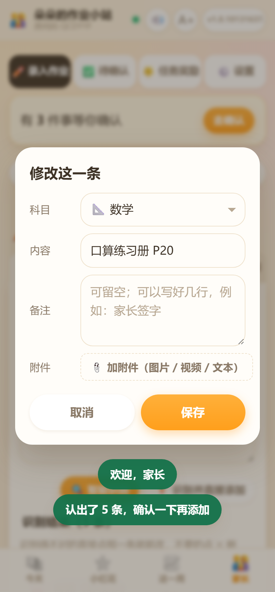 |  |

本周日期条，点哪天编辑哪天：

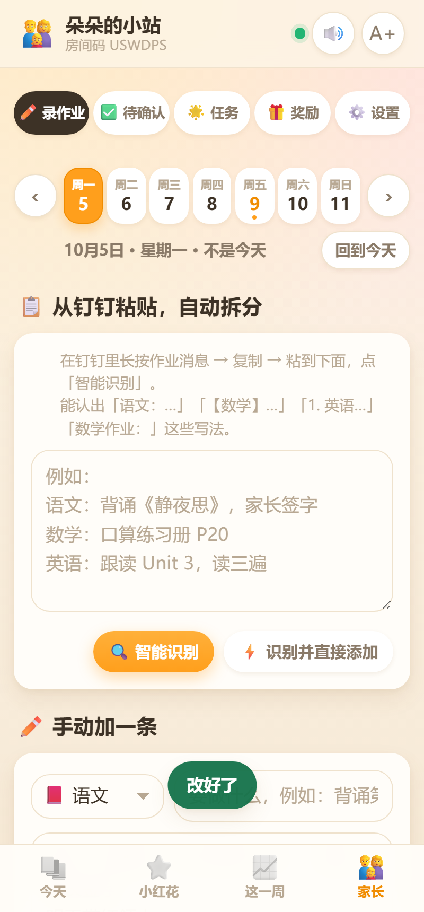

改作业时能单独设这一条值几朵小红花：

| 修改框 | 改完后的列表 |
|---|---|
|  | 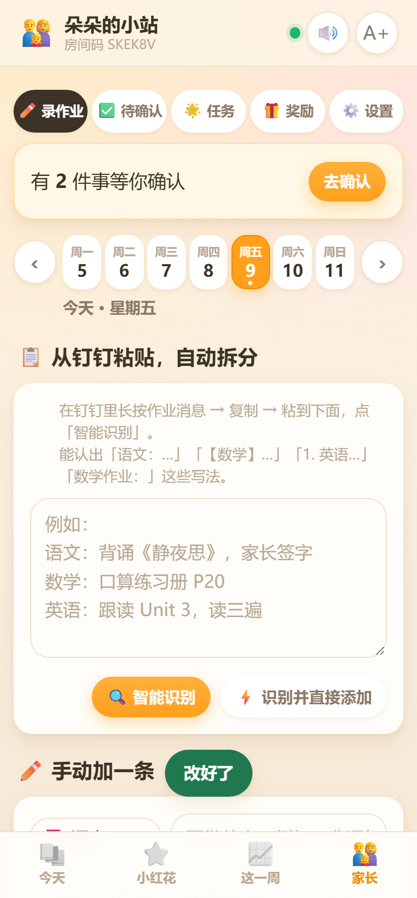 |

**待确认清单**：孩子做完的作业、任务，加上孩子提出的兑换申请，都在这一页处理。

| 待确认（含兑换申请） | 驳回时写一句原因 | 孩子那边看得到 |
|---|---|---|
|  |  |  |

**家长端进门要 4 位密码**，键盘和密码盘都能输：

| 密码盘（键盘也能敲） | 设置页 | 还没有内容时 |
|---|---|---|
| 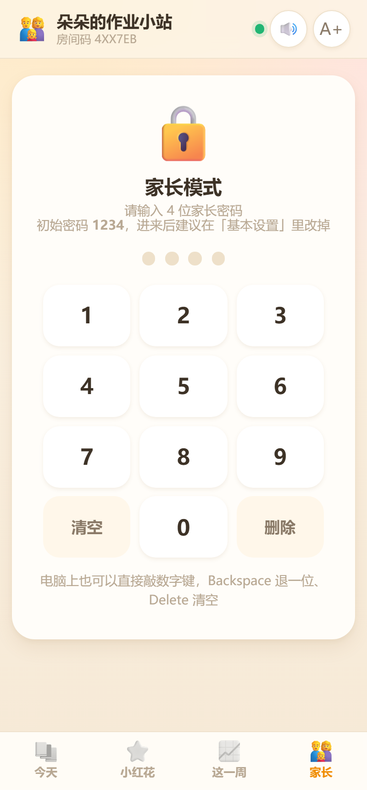 |  | 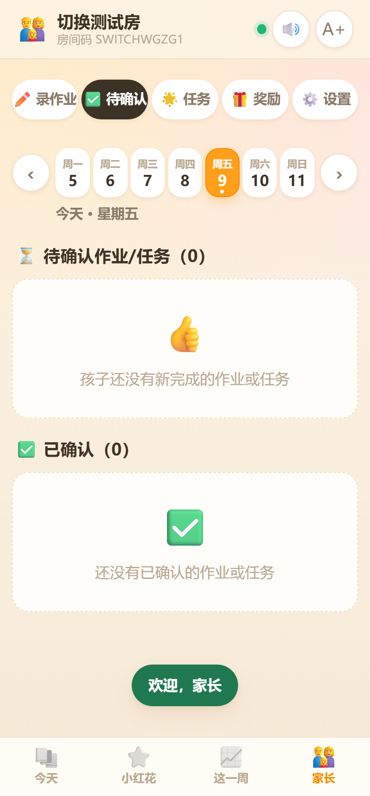 |

| 待确认整页 | 家长端还是空的 |
|---|---|
| 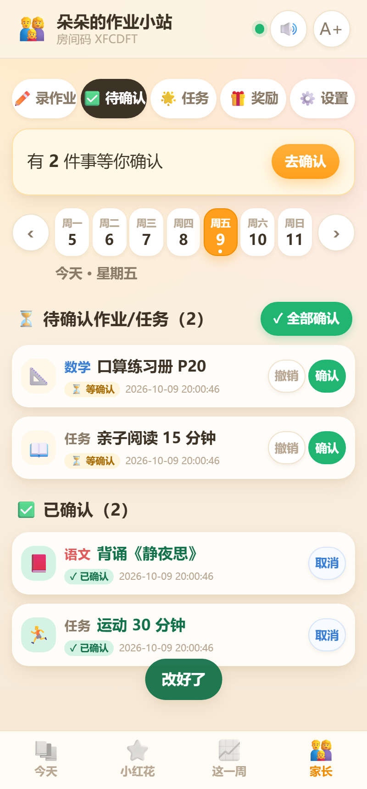 |  |

新增任务 / 奖励时可以点选常用图标，孩子兑换后家长兑现：

| 选图标 | 兑换已兑现 |
|---|---|
|  | 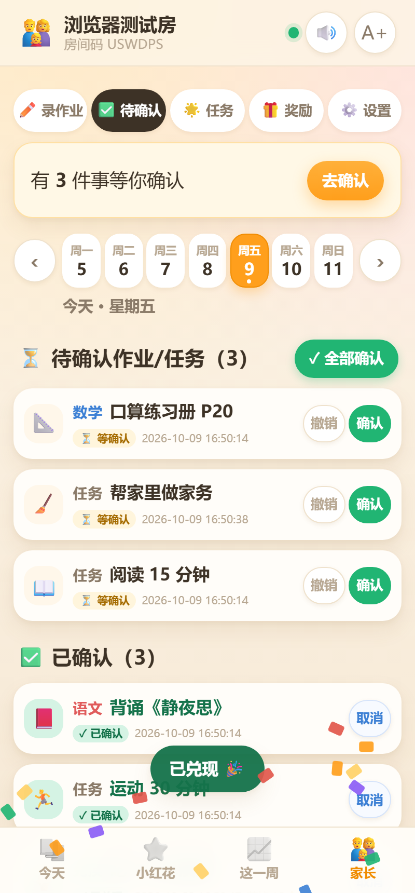 |

**同步**
- 每个家庭一个**房间码**，比如 `N7RW94`（也可以自己定成 `duoduo` 这种好记的）
- 同一房间码的设备看到的是同一份数据，改动几秒内自动同步
- 一台设备可以进多个房间，在 **家长 → 设置 → 🏠 房间** 里随时切换
- 连不上服务器时会自动退回本机缓存，网好了自动补传

**手机上长这样**（顶栏和底部导航都钉住，只有中间的内容在滚）：


---

## 🚀 第一步：先在本机看看效果

需要电脑上装了 [Node.js](https://nodejs.org)（选 LTS 版本，一路下一步）。

**Windows**：双击 `start.bat`
**Mac / Linux**：终端里运行

```bash
cd homework-board
node server.js
```

然后浏览器打开 <http://localhost:5173>。

想先灌一份演示数据看看效果：

```bash
node scripts/demo-seed.mjs
```

它会打印一个房间码，按提示打开即可（家长密码 `1234`）。

> 本机模式只有这台电脑能访问。要让孩子在家里的平板上看到，需要下一步。

---

## ☁️ 第二步：放到公网（三选一）

### 方式 A：Cloudflare Workers —— 推荐，免费、不用信用卡 ⭐

数据存在 Cloudflare 的 KV 里，永久保存，免费额度（每天 10 万次请求）一家人用十年也用不完。

#### A-1 网页操作版（不用装任何东西）

1. 打开 <https://dash.cloudflare.com> 注册 / 登录
2. 左边选 **计算（Workers）** → **创建** → 选 **从 Hello World 开始** → 随便起个名字 → **部署**
3. 点 **编辑代码**，把编辑框里的内容**全部删掉**
4. 打开本项目里的 [`dist/worker.js`](dist/worker.js)，**全选复制**，粘进编辑框 → **部署**
5. 右上角能看到网址，形如 `https://xxx.xxx.workers.dev`，先别急着用
6. 回到 Cloudflare 首页 → **存储和数据库** → **KV** → **创建命名空间**，名字填 `HB_KV`
7. 回到刚才的 Worker → **设置** → **绑定（Bindings）** → **添加** → 选 **KV 命名空间**
   - 变量名称（Variable name）填：`HB_KV`
   - KV 命名空间选刚才建的那个
   - 保存
8. 再 **部署** 一次

完成。打开那个 `workers.dev` 网址就能用了。

> 忘了绑 KV 也能打开，只是数据不持久（刷新可能丢），所以第 6～8 步别跳过。
>
> 改了 `public/` 里的文件后，重新跑一次 `node scripts/build-worker.mjs` 再粘贴即可。

#### A-2 命令行版（有命令行基础的话更快）

```bash
cd homework-board
npx wrangler login
npx wrangler kv namespace create HB_KV     # 会输出一个 id
```

把输出的 id 填进 [`wrangler.toml`](wrangler.toml) 里的 `<改成你的KV命名空间id>`，然后：

```bash
npx wrangler deploy
```

以后改完代码重新 `npx wrangler deploy` 就行。

---

### 方式 B：Render + Upstash（也可以用）

Render 免费套餐重启会清空本地硬盘，所以数据要放到 Upstash（免费 Redis）。

1. 把整个 `homework-board` 文件夹传到 GitHub（新建仓库 → 网页上传即可）
2. 到 <https://upstash.com> 注册 → **Create Database** → 区域选离你近的（比如 Singapore）
3. 在数据库详情页找到 **REST API**，复制 `UPSTASH_REDIS_REST_URL` 和 `UPSTASH_REDIS_REST_TOKEN`
4. 到 <https://render.com> 注册 → **New** → **Blueprint** → 选中你的仓库
5. Render 会读 [`render.yaml`](render.yaml)，让你填上面那两个值，填好点部署
6. 一两分钟后拿到网址

---

### 方式 C：自己的云服务器 / NAS / 树莓派
```bash
cd homework-board
PORT=8080 node server.js
```

数据存在 `data/` 目录里。本项目**零依赖**，不用 `npm install`，随便什么能跑 Node 18+ 的地方都行。

**云服务器（VPS）有一键脚本**：

```bash
# 把 homework-board 传上去，然后
cd homework-board && sudo bash deploy/install.sh
```

它会装 Node、把代码放到 `/opt/homework-board`（保留原有 `data/`）、
注册 systemd 服务并启动，最后自检一遍接口。

配域名、上 HTTPS、用 Docker、日常备份和排查，都在 **[DEPLOY.md](DEPLOY.md)** 里。

**服务器上已经装了 1Panel？** 看 **[DEPLOY-1PANEL.md](DEPLOY-1PANEL.md)** ——
那份是 1Panel 专用的（容器 → 编排 → 反向代理 → 申请证书），别用上面的 systemd 脚本，
会跟面板的 Docker 和 OpenResty 打架。

---

## 👨‍👩‍👧 第三步：让孩子看到

1. 家长在自己手机（或公司电脑）上打开你的网址
2. 底部点 **家长** → 输入密码（默认 `1234`）
3. 进 **设置** → 点 **📋 复制网址**
4. 把这行网址通过钉钉/微信发到家里，在家里的平板或电脑上打开一次
5. 建议在平板上「添加到主屏幕」，孩子点图标就能进，跟 App 一样

**⚠️ 第一件事：把默认密码 `1234` 改掉。**

---

## 📖 每天怎么用

### 家长：收到钉钉作业后（大约 30 秒）

1. 在钉钉里长按老师的作业消息 → **复制**
2. 打开你的网址 → **家长** → **✏️ 录作业**
3. 粘进「从钉钉粘贴，自动拆分」的框里 → 点 **🔍 智能识别**
4. 看一眼拆分结果：识别得不对的，**直接点那一条就能改**（科目、内容、备注都能改），不要的点 ✕ 删掉
5. 点 **✓ 全部添加到今天**

如果老师发的格式很乱，用下面的「✏️ 手动加一条」补一下就行。

### 家长：调整顺序、内容和分值

**家长 → ✏️ 录作业 / 🌟 每日任务 / 🎁 奖励**，每一行右边都有一排按钮：

| 按钮 | 作用 |
|---|---|
| ↑ ↓ | 把这一条往上 / 往下挪一位（到顶或到底会变灰） |
| 停用 | 只出现在每日任务：暂时不显示给孩子，以后还能启用 |
| ✎ | 改内容。**作业还能单独改这一条值几朵小红花**（留空就跟着全局分值） |
| ✕ | 删掉 |

调整后的顺序就是孩子那边看到的顺序。

### 家长：切换日期

**录作业**和**待确认**的顶部有一条**本周日期条**，周一到周日七天都在上面，
今天的日期下面有个小圆点。点哪天就编辑哪天，要跳回来点右边的「回到今天」。

### 家长：确认和驳回

**家长 → ✅ 待确认**，从上到下三块：

1. **🎁 孩子想兑换** —— 孩子在小红花页兑换后出现在这里。
   **兑现** 就是答应他；**驳回** 会让你写一句原因（有几个快捷说法可以点），
   原因会显示在孩子的小红花页，扣掉的小红花自动退回。
2. **⏳ 待确认作业/任务** —— 孩子做完的作业和任务。**确认** 小红花到账，**撤销** 是打回重做。
   也可以点 **✓ 全部确认** 一次搞定。
3. **✅ 已确认** —— 确认过的作业、任务，以及**已经兑现的兑换**，点「取消」可以退回。

> 其它四个模块顶部都有「有 N 件事等你确认」和靠右的 **去确认** 按钮，一点就跳过来。

### 孩子：做作业 + 专注时间

1. 在没做完的作业卡片上点右边的 **⏱**（在 🔊 后面那个），或者直接点卡片，
   **整页**会变成倒计时（默认 20 分钟），屏幕上只剩这一项作业和一个大圆环
2. 圆环顺时针走着收口，数字是剩余时间
3. 做完按 **✓ 我做完了** —— 这一项就打上勾，专注结束并撒花庆祝
4. 20 分钟到了还没做完，整页会换成绿色的休息页，倒计时 5 分钟，
   还会轮换提示「站起来伸个懒腰」「看看窗外」等；休息完自动开始下一轮
5. 想中途退出，点 **先不专注了**

> 时长可以在 **家长 → 设置 → ⏱ 专注时间** 里改，也可以整个关掉专注按钮。
> 计时只存在孩子这台设备上，不占云端的同步数据；关掉页面再打开会接着算。

### 孩子：每日任务和额外任务

这些还是点一下卡片就打勾，卡片会变绿。如果开着「家长确认」，
会显示「⏳ 等爸爸妈妈确认」，小红花先不进账。

**「✨ 我还有别的事想做」是孩子自己加的**，所以家长那边也有个口子：
家长 → 录作业 → **「✨ 额外的任务」**，每条都能 `✎` 改（图标 / 内容 / 分值）、
`✕` 删、`↑↓` 调顺序。删一条已经确认过的，会把发出去的小红花一起收回来
（流水里记一笔「删除：…」）；改分值同理，账面会跟着重算。


---

## ❓ 常见问题

**Q：换了手机/电脑，怎么看到原来的数据？**
打开带房间码的网址就行，格式是 `你的网址/?room=XXXXXX`。
在同一个服务器上换个设备，直接进 **家长 → 设置 → 🏠 房间** 就能看到所有房间，
点「切换」进任何一个；也可以点那一行的 `📋` 把网址复制走。

**Q：家里两个孩子，或者想给自己留个测试房间？**
家长 → 设置 → 🏠 房间 → **➕ 新建房间**，可以顺手起个房间名。
之后在列表里点「切换」，每个房间的数据完全独立，互不影响。

**Q：房间管理口令是干嘛的？忘了怎么办？**
**只用在删除房间时确认一下**，平时浏览房间列表、切换房间、改房间名都不需要它。

- **可以完全不设** —— 那删房间就只靠「把房间码打一遍」兜底
- 想设就在 **家长 → 设置 → 🏠 房间 → 🔓 设个删除口令**，至少 6 位
- 服务器上**只存 scrypt 哈希**（`data/_admin.json`，权限 0600），**文件里没有明文**
- 忘了：删掉 `data/_admin.json` 重启服务，口令就没了（删房间退回只核对房间码）
- 也可以在部署时用环境变量 `HB_ADMIN_KEY` 指定，那样网页上就不能改

> 用**哈希**而不是「加密」是有意的：可逆加密的密钥也得放在同一台服务器上，
> 等于把钥匙和锁放一起；口令只需要验证对不对、不需要还原，所以单向哈希才是对的。

**Q：房间列表不需要口令，别人会不会看到我家的作业？**
列表确实不需要口令（这是按「一台服务器就是一个家庭」设计的）。
但**要进某个房间还是得有那个房间的房间码**：默认是 6 位随机字符（约 10 亿种组合），
不容易猜到。所以列表暴露的是「有哪几个房间、叫什么名字、余额多少」，不是作业内容本身。

如果这台服务器不只你一家人在用，想更保险：
① 别自定义太好猜的房间码；② 在 nginx / Cloudflare 那一层加访问控制；③ 每家一台服务器。

**Q：网址发出去，别人会不会看到我家的作业？**
房间码默认是 6 位随机字符（约 10 亿种组合），不容易猜到。但请把它当成"家人之间的暗号"，
不要发到公开的群里。**自定义房间码尤其要当心**——`duoduo` 这种好记的码别人也容易试出来，
所以定的时候界面会提醒你。想更保险的话，在 Cloudflare 那一层加个 Access 访问策略即可。

**Q：家长密码忘了怎么办？**
本机模式下删掉 `data/房间码.json` 重新开始；云端模式在 Cloudflare 的 KV 里删掉对应键。
或者提前在设置里 **导出备份**，随时可以导回来。

**Q：手上有一份旧存档，怎么知道它和当前版本的结构一不一样？**

按这个流程走（每次都一样）：

1. **先看**：把文件的顶层字段和一份 `normalizeState(defaultState())` 的字段清单比一遍，
   列出"缺什么 / 多什么"，并报出数据规模（天数、作业、附件、流水、小红花…）
2. **再升**：整份喂给 `normalizeState()`（服务器读存档用的同一个函数），
   这样"升级后的文件"和"服务器自己加载后的状态"逐字节一致
3. **验四组**：① 原有数据保全（每个值都还在、没被改写）
   ② 幂等（再升一次不变）③ 新字段补全 ④ 关键数据对账
4. **写真机**：**先备份原件**（`xxx.升级前备份.json`），再覆盖原文件
5. **★ 一定要把升级后的文件交还给用户** —— 用户明确要求过：
   > 「后续给你文件让你比对的，都要记得给我返还最新的升级后的文件」

> 注意 `tasksSortedByTag` 这类字段只有 `normalizeState()` 才会写，
> 拿 `defaultState()` 当基准会把它误报成"多出来的字段" —— 基准要用
> `normalizeState(defaultState())`。

**Q：孩子的平板一直开着，会实时更新吗？**
每 8 秒自动同步一次，切回页面时也会立刻同步。家长改完，孩子那边最多 8 秒后能看到。

**Q：作业的顺序能调吗？**
能。**家长 → ✏️ 录作业**，每一行下面点 ↑ ↓ 就能挪位置；每日任务和奖励也是同一套操作。
孩子那边看到的顺序和你调完的一致。

**Q：孩子点作业卡片怎么没打勾？**
故意的 —— 作业必须走专注页才算完成，免得一路点下去。
点卡片或者卡片右边的 **⏱** 都会进专注页，做完按「✓ 我做完了」。
每日任务还是直接点就完成。

**Q：孩子兑换了我不想给的奖励怎么办？**
**家长 → ✅ 待确认 → 🎁 孩子想兑换**，点「驳回」可以写一句原因
（比如「今天已经换过啦」，也有几个快捷说法可以点）。孩子在小红花页会看到
「爸爸妈妈说：…」，扣掉的小红花自动退回。

**Q：我改了代码（或者你帮我改了），页面上怎么还是旧的？**
浏览器会一直跑"打开这一页时"加载的那份 JS，切标签页是不会重新加载的。
现在页面每 8 秒会比对一次服务器上的文件版本，换了新的就会自己弹出一条提示：


点「点我刷新」就行。也可以随时 **Ctrl + F5**（Mac 是 **Cmd + Shift + R**）强制刷新。

**Q：孩子的专注倒计时，我在公司能看到吗？**
看不到，也不该看到 —— 计时存在孩子那台设备上，不参与云同步。你只会在「待确认」里看到他做完了。

**Q：专注时间能改吗？**
能。**家长 → 设置 → ⏱ 专注时间**：专注 5～60 分钟、休息 1～30 分钟，也可以整个关掉专注按钮。

**Q：钉钉粘贴识别得不对？**
识别规则在 [`public/core.js`](public/core.js) 的 `parseHomeworkText` 里，改起来很容易。
界面上的识别结果也能直接点开改，不用去动代码。

**Q：能加第二个孩子吗？**
再新建一个房间就是独立的一份数据，网址不同即可。

---

## 🗂 项目结构

```
homework-board/
├── public/                 前端（纯静态，没有构建步骤）
│   ├── index.html
│   ├── style.css
│   ├── core.js             ★ 核心逻辑：数据模型 / 文本解析 / 积分结算
│   ├── ui.js               纯 UI 原语：弹窗 / 提示条 / 音效 / 撒花（不碰应用状态）
│   ├── changelog.json      版本号 + 更新历史（由 version-bump.mjs 自动维护）
│   └── app.js              界面与交互、事件分发
├── server.js               本机 / 自有服务器用的 Node 服务（零依赖）
├── worker.js               Cloudflare Worker 入口（wrangler 部署）
├── worker/handler.js       Worker 的 API 层（两种部署方式共用）
├── wrangler.toml           Cloudflare 配置
├── render.yaml             Render 配置
├── dist/worker.js          ← 打包好的单文件 Worker（用于网页版粘贴）
├── scripts/
│   ├── lib/cdp.mjs         浏览器测试共用的 CDP 客户端（smoke / screenshot 共用）
│   ├── build-worker.mjs    打包单文件 Worker
│   ├── selftest.mjs        核心逻辑自测（394 项）
│   ├── apitest.mjs         HTTP 接口联调测试（134 项）
│   ├── workertest.mjs      单文件 Worker 测试（62 项）
│   ├── deploytest.mjs      部署文件体检（116 项）
│   ├── smoke.mjs           浏览器冒烟：一次加载查最要紧的那些（31 项）
│   ├── rooms.mjs           清理攒下来的房间（默认演练，加 --yes 才真删）
│   ├── version.mjs         算「前端指纹」，用来查服务器上是不是最新代码
│   ├── version-bump.mjs    按内容指纹自动编排版本号，并记下这次改了什么
│   ├── demo-seed.mjs       灌演示数据
│   ├── screenshot.mjs      用 Chrome 无头模式跑完所有页面：截图 + 查报错/横向溢出
│   └── updatetest.mjs      验证「有新版本」提示条（改文件后页面会不会自己发现）
├── deploy/                 部署到云服务器用的（详见 DEPLOY.md）
│   ├── install.sh          Ubuntu / Debian 一键安装
│   ├── homework-board.service  systemd 服务模板
│   ├── nginx.conf          反向代理 + HTTPS 示例
│   ├── Dockerfile
│   └── docker-compose.yml
├── docs/images/            说明文档用的截图
├── start.bat / start.sh    一键启动
└── data/                   本机模式的数据目录（自动生成）
```

### 设计要点

- **零依赖**：不需要 `npm install`，不需要打包工具，`core.js` 用原生 ES Module 同时跑在浏览器和 Node 上。
- **操作日志式同步**：前端不直接改数据，而是发一串"操作"（op）给服务器；服务器用**同一份**
  `applyOp` 代码重新算一遍。所以积分、确认状态永远不会两边对不上。
- **乐观更新**：点一下界面立刻变，操作在后台排队发送；断网也能继续用，恢复后自动补传。
- **专注计时是本机的**：孩子打到一半关掉页面再打开，倒计时按结束时刻接着算（存 `endsAt`
  时间戳，不存"还剩多少秒"）。所以家长的手机上不会看到孩子的倒计时，也不会因为同步把计时冲掉。
- **存储可插拔**：本机文件 / Upstash Redis / Cloudflare KV 三套实现，接口一致。
- **应用外壳布局**：`body` 自身是 `overflow: hidden` 的，整页分「顶栏 / `#scroller` / 底栏」
  三段，**只有中间那段在滚**。这样底栏才能在任何浏览器上真正钉死在最底下 ——
  如果让文档本身滚动，手机浏览器地址栏收放时会改变可视视口高度，
  `position: fixed` 的底栏就会跟着页面上下漂。代价是所有"回到顶部"都要
  `scrollToTop()` 去滚 `#scroller`，不能再调 `window.scrollTo`；
  横向溢出也要量 `#scroller.scrollWidth`（它的 `overflow-x` 是 hidden，
  只量 `documentElement` 永远是 0，检查会静默失效）。这两点测试里都盯着。
- **前后端共用一份逻辑**：房间列表要露哪些字段（`roomBrief`）、口令从请求哪里取
  （`roomKeyFrom`）都放在 `core.js` 里给 `server.js` 和 `worker/handler.js` 共用 ——
  以前两边各写一遍，改一处忘另一处就会出现"本地能看、云端看不到某个字段"。
- **删掉东西要把小红花收回来**：`revokeAward()` 专门干这个。**删除时不能直接调
  `settle()`** —— `settle()` 判断的是「该发却没发 / 不该发却发了」，而删除那一刻
  记录的 `done` / `confirmed` 还是 true，`settle()` 会认为"本来就该发"，直接空转，
  结果东西删了、星星还留在账上。这条有回归测试盯着。
- **数字输入的口径统一**：填了 `0` 就是 `0`（0 对任务分值是合法值），
  留空才走默认 / 保留原值。以前用的是 `Number(v) || 默认值`，于是用户明明填了 0
  会被当成"没填"悄悄换掉，而且同一个 0 在"新建"时变成 10、"编辑"时变成 1。
- **一套按钮走全站**：样式里只有几档按钮 —— `.btn`（主要动作）、`.chip`（文字小胶囊）、
  `.act-btn`（单个符号的圆按钮）、`.room-act`（房间行里的文字按钮），配中性 / 蓝 / 绿 / 红
  四种语义色；家长端的 ↑↓✎✕、日期栏的 ‹ ›、顶栏的图标按钮都出自这同一套，
  所以颜色和手感是统一的。输入框也只有 `.field` 一个类，聚焦时统一是橙色描边 + 光晕。

### 版本号

界面右上角显示版本号，格式 **`v1.0.月日时分.四位随机码`**（例 `v1.0.10102311.a3f9`），
**点一下能看到这次和最近几次更新了什么**。

版本号不是手写的，是按 `public/` 里前端文件的**内容指纹**自动编排的：

```bash
node scripts/version-bump.mjs "休息页加了转圈倒计时" "每日任务支持备注"
```

- 内容没变 → 什么都不做
- 内容变了 → 自动编一个新版本号（时间那段保证递增），把说明记进 `public/changelog.json`
- 只改 `changelog.json` 本身**不会**触发新版本（指纹不算它），否则就永远升不完

`deploytest` 会检查「版本号和内容同步」：改了代码忘了升版本，它会红着提醒你跑上面那条命令。
所以**发布前先 `version-bump`、再 `build:worker`**。

### 更新代码之后，一定要重启服务

`server.js` 是在**启动时**把 `public/core.js` import 进来的。所以：

| 改了什么 | 要做什么 |
|---|---|
| 只改 `public/` 下的前端文件 | 传上去、刷新页面就行（重启更保险） |
| 改了 `core.js`（加了新的操作类型） | **必须重启服务 / 重启容器** |

**不重启会怎样**：浏览器里是新代码，服务器上还是旧的 `core.js`。
旧服务器不认识新操作，**"点了没反应""删了又回来"**，而且一声不吭。

这一版开始，服务器遇到不认识的操作会**明确回 400**，前端也会弹一句
「服务器还是旧版本，刚才的操作没能保存。重启一下服务再试。」
所以这个问题现在一眼就能看出来，不会再静默失败。

> `1panel-compose.yml` 是挂载 `/opt/homework-board:/app`，前端文件改完立刻生效，
> 但 `server.js` / `core.js` 要**重启容器**才生效。

### 数字输入框为什么不用 `type="number"`

因为踩过一个很难发现的坑：

```html
<input type="number" value="-1">   <!-- Chrome 屏幕上显示成「1-」 -->
<input type="text" inputmode="numeric" value="-1">   <!-- 正常显示 -1 -->
```

DOM 里的 `value` 明明是 `-1`，读代码、读 `value`、写单测**都查不出来**，
只有截图才看得见负号跑到了数字后面。换成 Arial / Tahoma / Segoe UI / system-ui
等 7 种字体栈试过，**都一样**，所以跟字体无关，是 Chrome 对 `number` 输入框的处理。

所以本项目里所有数字输入都写成 `type="text" + inputmode="numeric"`，
**上下加减按钮是自己画的**（`.num-wrap` + `.num-step`，见 `app.js` 的 `numBox()`），
照样能点加减、照样唤起手机数字键盘。

`deploytest.mjs` 和 `screenshot.mjs` 各有一条检查盯着「不许出现 `type=number`」。

### 一个圆角写错，整块看着「只做了一半」

页签紧贴着下面那张卡片，接缝处两边都该是直角。原来写的是：

```css
.add-tabs + .form-card { border-radius: 0 var(--r-md) var(--r-md) var(--r-md); }
/*                                    ↑左上  ↑右上   ↑右下    ↑左下   */
```

`border-radius` 四个值依次是 **左上 / 右上 / 右下 / 左下**。这里只把**左上**写成 0，
右上还是圆的 —— 同一个卡片左边直角、右边圆角，而且右上那处还和上面页签的圆角
叠成两层弧线。家长截图圈出来写「参考左边处理」，说的就是这个。

正确写法（上下各管两个角）：

```css
.add-tabs + .form-card { border-radius: 0 0 var(--r-md) var(--r-md); }
```

> 三值简写（`0 18px 18px`）更容易踩这个坑：它等价于 `0 18px 18px 18px`，
> 只有左上被改掉。**上下不一样就写全四个值**，能少一类错。

`screenshot.mjs` 会断言：卡片上面两个角相等、下面两个角相等、左上必须是 0，
并且选中页签的下边也得是直角（不然和卡片之间会有缝）。

### 附件：为什么不用 multipart

上传走**原始字节**，不是 `multipart/form-data`：

```
POST /api/upload/<房间码>?name=<编码过的文件名>     body = 文件本身的字节
GET  /api/file/<房间码>/<id>                        支持 Range（手机看视频要拖进度条）
```

浏览器那一侧一行就够：

```js
fetch('/api/upload/' + room + '?name=' + encodeURIComponent(file.name),
      { method: 'POST', body: file })     // File 直接当 body
```

这么做的理由：

- **零依赖**把 multipart 解析写对并不轻松（边界串、编码、文件名里的引号），
  而这套只需要文件名和字节，用 query + body 就全拿到了
- 前端不用 `FormData`，**传的就是文件本身**，没有 base64 膨胀、没有二次拷贝
- 服务端拿到 `Buffer` 直接落盘，`GET` 用 `createReadStream` 流式发回去

**安全上必须自己兜住的几点**（都有测试盯着）：

| 风险 | 做法 |
|---|---|
| 传个 `.html` / `.svg` / `.js` 上来当 XSS 跳板 | **扩展名白名单**（`UPLOAD_EXTS`），不在表里一律 400 |
| 用 `../../etc/passwd` 当 id 穿越目录 | id 由服务端生成，且 `isUploadId()` 只认 `^[a-z0-9]{16}\.[a-z0-9]{1,8}$` |
| 传个大文件把服务器拖死 | 边收边计数，超上限**立刻中断连接**并回 413 |
| 手机上视频拖不动进度条 | `GET` 支持 `Range`，越界回 416（Safari 不支持 Range 时经常干脆不播） |

存储位置和限额：

| 部署方式 | 存在哪 | 上限 |
|---|---|---|
| `node server.js`（本机 / Docker，**推荐**） | `data/uploads/<房间码>/<id>` | 默认 25MB，`HB_MAX_UPLOAD_MB` 可改 |
| Cloudflare Worker | KV 里存 base64 | 8MB（KV 单值 25MB，base64 还要涨 1/3） |
| 配了 Upstash Redis | **不支持附件** | 前端会自动隐藏上传按钮 |

前端靠 `GET /api/health` 的 `attachments` / `maxUploadMB` 决定显不显示上传按钮 ——
宁可少一个按钮，也不要让家长传完才发现存不下。

> 删房间时会连 `data/uploads/<房间码>/` 一起删掉，不然磁盘上会留一堆没人引用的文件。

### 手机端布局：中文会「一字一行」竖排

真机上遇到过顶栏标题竖着排、一个字一行。原因不是字体，是 **flex 收缩**：

- `.topbar` 是 flex 行，左边 `.topbar-left { min-width: 0 }`，右边一排控件也没写 `flex: none`
- 两边一起缩，左边被压到几十像素
- **中文没有"词"的概念，任何位置都能换行** → 一行一个字，成了竖排

三条规矩：

1. **可能被压窄的文字容器一律 `white-space: nowrap` + `text-overflow: ellipsis`**，
   挤不下就省略号，绝不换行
2. **右边那排控件 `flex: none`**（不参与收缩），左边 `flex: 1 1 auto` 撑满剩下的
3. 窄屏用 `@media (max-width: 26rem)` 收一档；**媒体查询必须放在基础规则之后** ——
   同优先级下比的是先后，放前面会被整段盖掉。
   踩坑现场：`matchMedia('(max-width: 26rem)').matches` 明明是 `true`，
   但 `.icon-btn` 还是 41px、版本号还是 140px。查了半天才发现是顺序问题。

> 媒体查询里的 `rem` 按**浏览器初始字号（16px）**算，和页面的 `:root { font-size }` 无关。
> 这个项目根字号是 18px，所以 `max-width: 26rem` 实际卡在 416px，不是 468px。

行内那一排小按钮：窄屏给标题一个 `min-width`，装不下时**按钮整体换到第二行**靠右，
而不是把按钮改小 —— 手机上这些是主要点击目标，不为了排版牺牲手感。

`screenshot.mjs` 会断言：顶栏文字只有 1 行、标题没被省略号截掉、没有元素横向溢出、
以及窄屏那几条规则**确实生效了**（不是只写在那儿）。

### 「点了没反应」是怎么来的（很容易踩的一类）

按钮明明在屏幕上、位置也对，点下去却什么都不发生。已经踩到过**四种**完全不同的成因。
**④ 最隐蔽：一个错都不报**，查了好几轮才逮到。

**④ 新增记录的 id，客户端和服务器算得不一样。**

`uid()` 两边各自随机，于是：

1. 家长点「加进这一天」→ 客户端**乐观更新**，用随机 id `h_8e43f962` 把这条画到界面上
2. 同一个 op 发给服务器 → 服务器**又随机一个** `h_d27a9e9e` 落库
3. `poll()` 发现 rev 变了 → 用服务器的 state 整个替换本地的
4. 界面上那张卡片（这次渲染还没被换掉）手上还捏着 `h_8e43f962` →
   点它身上的 ☆ / ✎ / ✕ 时 `findItem` 找不到 → `break` → **什么都不发生，也不报错**

**修法：新增类的 op 一律由发起方先把 id 造好塞进 op 里**，服务器原样采用
（`core.js` 的 `useId()` / `isSafeId()`）。服务器自己找源头的那些（比如「复制到今天」）
不能随机，必须**由种子推出来**（`derivedId()`）。

守卫：`selftest` 里一组"同一个 op 在两边各跑一遍，id 必须一样"；
`apitest` 里直接对服务器喊"你就用这个 id"，再看它用没用；
`screenshot` 里加完作业立刻点它的「修改」，弹窗必须打得开。

**③ 按下和抬起之间，按钮被整个重建了 —— 这时 `click` 根本不会派发。**
`poll()` 在 rev 变化时会 `render()`，把 `innerHTML` 整块换掉。按下时那个元素
就成了"已分离"的孤儿，而**规范行为是：mousedown 的目标被移除时不派发 `click`**。
所以写在 `click` 里的兜底永远没机会跑。

**② 按下和抬起之间，内容动了位置。**
浏览器把 `click` 派发到「按下点」和「抬起点」的**共同祖先**上，而不是按钮上。
那个祖先通常是 `#view`，没有 `data-act`，于是什么也不做。
成因：列表刚加了一行、平滑滚动正在进行、Chrome 的「滚动锚定」偷偷调 `scrollTop`。

**① 按钮不在点击委托覆盖的区域里。**
弹窗挂在 `#modal-root` 上，是 `#view` 的兄弟节点。`onViewClick` 只在
`#view / #rest / #focusmask / .modal` 里才走，漏掉 `.modal` 的话弹窗里所有
`data-act` 按钮都是死的。（踩过：任务/奖励里的小红花加减。）

针对 ①②③ 的四道防线：
- 点击处理里**先找 `[data-act]` 再做区域判断**（顺序反了会在 ① 里空转）
- `pointerdown` 时记下按钮，**同时记一个用 data 属性拼出的选择器** ——
  元素被替换掉时，用选择器在新 DOM 里找回"同一个按钮"
- 兜底挂在 **`pointerup`** 而不是 `click`（③ 里 `click` 不来）；
  并且等 50ms 再看一眼：如果 `click` 正常处理过就把 `pressedAct` 清掉了，不重复动作
- `#scroller` 上 `overflow-anchor: none` 关掉滚动锚定；加完新行**只高亮不滚动** ——
  绝不在家长刚点完的地方挪页面

`screenshot.mjs` 里有两条对应的回归测试：
- 按住 ☆ → 插入 160px 内容制造重排 → 抬起
- 按住 ✎ → 把 `#view.innerHTML` 整块换掉（等价于 `poll()` 后 `render()`）→ 抬起

两条都断言"这一下必须被处理"。

### 测试里的两种「点击」，别搞混

`scripts/lib/cdp.mjs` 提供两个点击函数，**它们能抓的问题不一样**：

| 函数 | 怎么点的 | 能抓到 | 抓不到 |
|---|---|---|---|
| `click(sel)` | `el.click()` | 逻辑对不对 | **绕过命中测试**：元素被别的层盖住、或根本在屏幕外，它照样"点得到" |
| `realClick(sel)` | 滚到元素 → 按坐标发 `mousePressed`/`mouseReleased` | 遮挡、错位、屏幕外、点击被别的东西接走 | 慢一些 |

默认用 `click()`；**凡是"按钮在、看着也能点、就是没反应"这类问题，必须用 `realClick()`**。
`realClick` 还会返回那个坐标上真正接到点击的元素，排查时很有用。

> 这条是踩出来的：弹窗里的加减按钮全都不工作，而 `mustClick` 一路绿灯。

### 弹窗里的按钮为什么要单独提一句

**弹窗是挂在 `#modal-root` 上的，不在 `#view` 里面。**
而所有 `data-act` 按钮都靠 `#view` / `#rest` / `#focusmask` 上的委托处理
（`document.addEventListener('click', ...)` 里有个区域判断）。

漏掉 `.modal` 的话，**弹窗里任何靠 `data-act` 委托的按钮都是"看得见、点得着、就是没反应"**
—— 踩过：任务/奖励里的「小红花」上下加减在弹窗里完全点不动，而在设置页（不在弹窗里）却好好的。

现在判断里带上了 `.modal`，并且 `screenshot.mjs` 会**真的点一下**弹窗里的加减按钮、
比对数值有没有变（只检查"按钮在不在"是不够的）。

### 部署之后：怎么知道服务器上跑的是不是最新代码

**症状**：更新了代码、也传上去了，但网页上「某个功能就是没有」
（比如房间列表点不动、新建房间时自定义房间码不生效）。

**十秒确认**：

1. 打开网站 → **家长 → 设置**，页面最底下写着 `前端版本 xxxxxxxx`
2. 在有你代码的那台电脑上跑：

```bash
node scripts/version.mjs
```

**指纹一样** = 服务器上跑的就是这份代码；**不一样** = 有文件没传上去，或者传的是旧的。

也可以让它自己比：

```bash
BASE=https://你的域名 node scripts/version.mjs --online
```

指纹是拿 `public/` 里每个文件的**内容**算的（不是文件时间），所以两边可以直接比；
对不上时它会告诉你**缺了哪个文件**。

> 传代码时**整个 `public/` 文件夹一起传**，别只挑改过的。
> 这个项目一直在加新文件（比如 `public/ui.js`），而 `app.js` 里
> `import './ui.js'` —— 少传一个，轻则某个功能没生效，重则**整个页面白屏**。
> 用 1Panel 的话详见 [DEPLOY-1PANEL.md](DEPLOY-1PANEL.md)。

### 跑测试

**不用起服务、不用 Chrome 的那三套**（核心逻辑 + 部署体检 + Worker）：

```bash
npm test
# 等价于：
#   node scripts/selftest.mjs && node scripts/deploytest.mjs && node scripts/workertest.mjs
```

> `deploytest` 会检查 `dist/worker.js` 有没有跟源码脱节。它报
> 「改过 public/xxx 但没重新打包」是**故意的** —— 跑一下 `npm run build:worker` 就好，
> 不要把它改成"测试前自动重建"，那样这条检查就永远抓不到东西了。

**日常改完代码**：上面那套 + 浏览器冒烟（冒烟要服务 + Chrome）。

```bash
npm start                                    # 另开一个窗口（或 node server.js）
node scripts/smoke.mjs <房间码>               # 浏览器冒烟：一次加载，十几秒
WIDTH=375 node scripts/smoke.mjs <房间码>     # 换个宽度再来一次
```

**冒烟**一次加载页面就查完最要紧的那些：脚本没报错、首页两个圆环、日期格式、
问候语一行、没有空白的详细要求行、两个清单都有计数、三个页面都能开、
家长密码能进、房间标题栏三个按钮同一行、保存和孩子名字同行、当前房间置顶、
房间行是文字按钮、当前房间不给删、其他房间折叠成一摞（等宽、互相遮挡约 2/3）、
点中间能展开收起、没有横向溢出、**页面本身不能滚且底栏钉死在最底下**。

**改完要细查**再跑全量的：

```bash
npm run test:api               # HTTP 接口（要服务在跑）
npm run build:worker && node scripts/workertest.mjs   # 单文件 Worker
node scripts/updatetest.mjs <房间码>   # 「有新版本」提示条
```

全流程的「真机」检查（用本机 Chrome 把每个页面点一遍并截图，
需要先自己起一个带 `--remote-debugging-port` 的 Chrome）：

```bash
node scripts/screenshot.mjs <房间码>       # 录作业/待确认/兑换/专注/休息/切房间 全走一遍
WIDTH=320 CHECK_ONLY=1 SKIP_SLOW=1 node scripts/screenshot.mjs <房间码>   # 换宽度只检查不截图
```

> 两个都要 Chrome 在跑：
> ```
> chrome --headless=new --no-sandbox --disable-gpu --remote-debugging-port=9333 about:blank
> ```

`screenshot.mjs` 里有三段「家长页 30 秒自动上锁」的计时测试，是真等 30 秒的
（没为了跑测试在生产代码里留"能改锁定时间"的后门）。跑很多遍的宽度扫描
用 `SKIP_SLOW=1` 跳过，它会打印 `⊘ SKIP_SLOW=1，跳过…`，不会静默缩水。

### 四类守卫

这几处特别容易"改了这边忘了那边"，一旦漏了，症状都是**用户那边白屏或跑不起来**，
所以测试里专门盯着：

1. **`scripts/build-worker.mjs` 里的 `__core` 清单** —— `worker/handler.js` 需要哪些
   core 函数，就得在那儿列出来。漏一个，打包出的 `worker.js` 里那个名字就是
   `undefined`（踩过一次：Worker 版建房直接 500）。`deploytest.mjs` 会解析两边并比对。
2. **`scripts/build-worker.mjs` 里的 `STATIC_FILES` 清单** —— `public/` 下每个前端文件
   都要列进去。漏一个，单文件 Worker 上那个文件就 404，而 `app.js` 一旦 import
   不到它（比如新加的 `ui.js`），**页面直接白屏**。三道检查一起盯着：
   `deploytest`（清单 vs 目录）、`apitest`（服务器真的能取到）、`workertest`（Worker 真的能取到）。
3. **`dist/worker.js` 有没有重新打包** —— 它是提交进仓库的构建产物
   （方便直接复制粘贴到 Cloudflare），改了 `public/` 或 `worker/` 却忘了跑
   `node scripts/build-worker.mjs`，就会悄悄脱节。`deploytest.mjs` 做的是内容级校验
   （不能用文件时间比，git checkout 会把时间全打乱）。
4. **前端模块之间的 import 能不能解析** —— 这是白屏的**根因层**守卫，比上面三条都早：
   改了模块名、挪了文件、清单没同步，都会先在 `deploytest` 里露出来。
   同一条还顺带检查 `public/app.js` 依赖的每个模块都在 `STATIC_FILES` 里，
   以及 `deploy/1panel-check.sh` **没有退化回写死的清单**
   （它写死过一次：加了 `ui.js` 没同步，自检全绿，用户传完打开就是白屏；
   现在它直接从 `app.js` 的 import 推导，以后加模块不用改它）。

另外还有一条**编码**守卫：全项目任何文本文件都不能带 UTF-8 BOM。
Windows 上 `Set-Content -Encoding UTF8`（PowerShell 5.1）会自动加 BOM，而
`.sh` 开头带 BOM 在 Linux 上 shebang 直接失效（报 `bad interpreter`），
`index.html` 的 BOM 出现在 `<!DOCTYPE>` 之前还可能让浏览器进怪异模式。
这个坑一轮里踩过一次（4 个文件），所以留了检查。

### 清理攒下来的房间

跑测试、试功能会攒一堆房间：

```bash
node scripts/rooms.mjs                       # 只列出来，不动手
node scripts/rooms.mjs --keep ABC123         # 演练：除了 ABC123 都会删
node scripts/rooms.mjs --keep ABC123 --yes   # 真删
node scripts/rooms.mjs --older-than 7 --yes  # 只删 7 天没动过的
```

默认是演练。它会拦住"把所有房间删光"这种情况，服务器设了口令的话要带
`--key=口令`（或设 `HB_ADMIN_KEY`）。

---

作业小站 · 送给一年级的小朋友 💛
